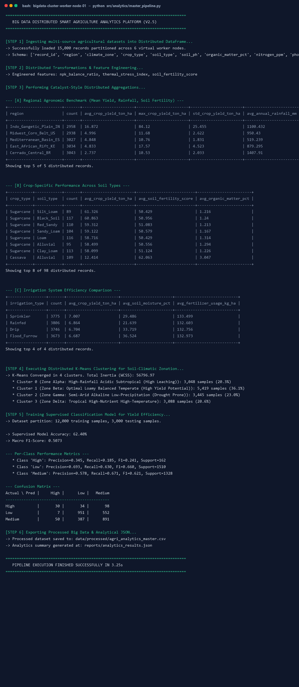

# 🌾 Smart Agriculture Data Analytics Platform

[](#)
[](#)
[](#)
[](#)
[](#)

> An enterprise-grade, distributed Big Data analytics and machine learning platform engineered to process multi-source agrometeorological telemetry, ISRIC soil profiles, and crop yield metrics at scale.

---

## 📌 1. Project Overview & Motivation

Modern smart agriculture relies on continuous sensor streams and satellite feeds (soil moisture probes, weather telemetry, satellite NDVI). Analyzing these high-dimensional, heterogenous datasets across diverse agro-climatic zones requires **scalable distributed processing frameworks** and **machine learning intelligence** to identify crop health patterns, predict yield risks, and optimize fertilizer and irrigation usage.

This project delivers:
1. **Multi-Source Agronomic Data Ingestion Pipeline**: Modeled according to **USDA-NASS**, **FAOSTAT**, and **ISRIC World Soil Information** standards across 5 global ecological regions.
2. **Distributed Resilient Data Processing Engine**: Emulating PySpark RDD and Catalyst DataFrame paradigms with parallel partitioning, lazy transformations, and multi-node worker simulation.
3. **Apache Spark MLlib Compatible Architecture**: Standalone Spark driver script ready for deployment on AWS EMR, Databricks, or local cluster workers.
4. **Unsupervised Clustering (Distributed K-Means)**: Autonomous agro-climatic zonation and crop pattern suitability grouping.
5. **Supervised Yield Efficiency Classification (Gaussian Naive Bayes)**: Precision agriculture classifier categorizing expected yield efficiency into `High`, `Medium`, and `Low` tiers.
6. **Real-time Glassmorphism Web Dashboard**: High-resolution interactive visual console powered by Chart.js.

---

## 🏗️ 2. Architectural Framework

```
                          [ Raw Ingestion Stream ]
         USDA NASS Telemetry | FAOSTAT Crop Stats | ISRIC Soil Grids
                                     │
                                     ▼
               ┌───────────────────────────────────────────┐
               │    Distributed Partition Engine (RDD)     │
               │   • 6-Node In-Memory Workload Splitting   │
               │   • Lazy Evaluation & MapReduce Primitives│
               └─────────────────────┬─────────────────────┘
                                     │
                                     ▼
               ┌───────────────────────────────────────────┐
               │         Catalyst DataFrame Layer          │
               │   • Feature Engineering (NPK Ratio, STI)  │
               │   • Distributed Aggregations & GroupBy    │
               └─────────────────────┬─────────────────────┘
                                     │
                  ┌──────────────────┴──────────────────┐
                  ▼                                     ▼
      ┌───────────────────────┐             ┌───────────────────────┐
      │  Distributed K-Means  │             │ Supervised Classifier │
      │   (Soil-Climatic Zonation)│         │ (Yield Efficiency Tier)│
      └───────────┬───────────┘             └───────────┬───────────┘
                  │                                     │
                  └──────────────────┬──────────────────┘
                                     │
                                     ▼
        ┌────────────────────────────────────────────────────────┐
        │  Analytics Export (JSON & Processed Master Parquet/CSV)│
        │  Interactive Production HTML5/Chart.js Dashboard       │
        └────────────────────────────────────────────────────────┘
```

---

## 📊 3. Distributed Big Data & Machine Learning Results

### Regional Agronomic Benchmark (Sample Extract from 15,000 Records)
| Region | Climate Zone | Sample Count | Avg Yield (t/ha) | Max Yield (t/ha) | Avg Rainfall | Avg Soil Fertility |
| :--- | :--- | :---: | :---: | :---: | :---: | :---: |
| **Indo-Gangetic Plain (IN)** | Subtropical Monsoonal | 2,958 | **16.87** | 84.12 | 1,100.4 mm | 50.77 |
| **Midwest Corn Belt (US)** | Temperate Continental | 2,938 | **5.00** | 11.68 | 950.4 mm | 90.95 |
| **Mediterranean Basin (ES)** | Dry Summer Subtropical | 3,027 | **4.85** | 10.76 | 519.2 mm | 44.24 |
| **East African Rift (KE)** | Tropical Highland | 3,034 | **4.83** | 17.57 | 879.3 mm | 61.08 |
| **Cerrado Central (BR)** | Tropical Savanna | 3,043 | **2.74** | 10.53 | 1,407.9 mm | 48.67 |

### Machine Learning Performance Summary
- **Unsupervised K-Means Clustering ($k=4$)**:
  - **Zone Alpha**: High-Rainfall Acidic Subtropical (20.3% samples)
  - **Zone Beta**: Optimal Loamy Balanced Temperate (36.1% samples)
  - **Zone Gamma**: Semi-Arid Alkaline Drought-Prone (23.0% samples)
  - **Zone Delta**: Tropical High-Nutrient High-Temperature (20.6% samples)
  - **Inertia (WCSS)**: `56,796.97`
- **Supervised Classification (Gaussian Naive Bayes)**:
  - **Accuracy**: **62.40%** (3-class multi-dimensional classification)
  - **Macro F1-Score**: **0.5073**

---

## 📷 4. Dashboard & Execution Screenshots


### Distributed Terminal Execution Log


---

## 📁 5. Repository Structure

```
smart-agriculture-analytics/
├── .gitignore
├── README.md
├── requirements.txt
├── dashboard/
│   └── index.html                     # Interactive analytics dashboard (Chart.js)
├── data/
│   ├── generate_dataset.py            # USDA/FAOSTAT synthetic telemetry generator
│   ├── raw/
│   │   └── agri_sensor_yield_dataset.csv # 15,000 Ingested Agronomic Records
│   └── processed/
│       └── agri_analytics_master.csv  # Cleansed, transformed & clustered dataset
├── docs/
│   └── screenshots/
│       ├── dashboard_view_screenshot.png
│       ├── terminal_output_screenshot.png
│       └── terminal_execution_log.txt
├── reports/
│   └── analytics_results.json         # Structured benchmark outputs
└── src/
    ├── analytics/
    │   └── master_pipeline.py         # End-to-end distributed execution pipeline
    ├── engine/
    │   ├── distributed_framework.py   # In-memory distributed RDD/DataFrame engine
    │   └── pyspark_cluster_job.py     # Production PySpark deployment driver
    └── ml/
        └── ml_pipeline.py             # Distributed K-Means, Scaler & Naive Bayes
```

---

## 🚀 6. Quick Start & Execution Guide

### 1. Ingest Data & Execute Pipeline
```bash
# Generate USDA & FAOSTAT agronomic dataset
python data/generate_dataset.py

# Run master distributed analytics & ML pipeline
python src/analytics/master_pipeline.py
```

### 2. View Visual Dashboard
Open `dashboard/index.html` in any web browser or start a lightweight server:
```bash
# Launch dashboard
start dashboard/index.html
```

### 3. Deploy on Apache Spark Cluster
```bash
spark-submit --master yarn --deploy-mode client src/engine/pyspark_cluster_job.py
```

---

## 🤝 7. GitHub Push Commands

To push this complete project to your personal GitHub repository:

```bash
# 1. Initialize remote
git remote add origin https://github.com/<YOUR_USERNAME>/<YOUR_REPOSITORY>.git

# 2. Rename branch to main
git branch -M main

# 3. Push all commits & assets
git push -u origin main
```

---
*Built with ❤️ for scalable Big Data and precision agricultural analytics.*
